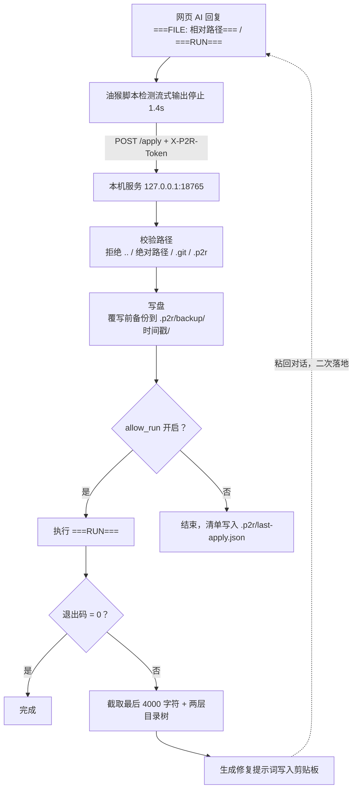

# Paste2Run

> 网页 AI 写好的代码，直接落进你本地的项目目录。
> **v0.3.1 · Python 3.8+ · 零第三方依赖 · 黑白极简 ASCII 控制台 · MIT License**

在 ChatGPT / Claude / Gemini / DeepSeek / 腾讯元宝 / 豆包里让 AI 生成完整项目时，最耗时间的往往不是写提示词，而是把一整页带文件名的代码逐个新建、复制、粘贴、保存。**Paste2Run** 把这一步变成全自动：AI 回复结束，文件已经在你的工程目录里，可选自动执行构建命令，报错还能一键生成修复提示词。

```text
██████╗  █████╗ ███████╗████████╗███████╗██████╗ ██████╗ ██╗   ██╗███╗   ██╗
██╔══██╗██╔══██╗██╔════╝╚══██╔══╝██╔════╝╚════██╗██╔══██╗██║   ██║████╗  ██║
██████╔╝███████║███████╗   ██║   █████╗   █████╔╝██████╔╝██║   ██║██╔██╗ ██║
██╔═══╝ ██╔══██║╚════██║   ██║   ██╔══╝  ██╔═══╝ ██╔══██╗██║   ██║██║╚██╗██║
██║     ██║  ██║███████║   ██║   ███████╗███████╗██║  ██║╚██████╔╝██║ ╚████║
╚═╝     ╚═╝  ╚═╝╚══════╝   ╚═╝   ╚══════╝╚══════╝╚═╝  ╚═╝ ╚═════╝ ╚═╝  ╚═══╝
```

## 工作流一览



一句话版本：AI 按标记输出 → 脚本自动 POST 到本机 → 校验后落盘并备份 → 可选执行命令 → 失败就把报错和目录树变成修复提示词。

## 核心特性

- **零依赖单文件服务**：仅需系统自带 Python 3.8+，无需 `pip install`，一个 `p2r.py` + 一个 `p2r.user.js` 即可运行。
- **黑白极简 ASCII 控制台**：启动后自动打开本地控制台，支持深黑 / 纸白一键反色切换、三套 Prompt 协议切换（标准 / 严格 / 增量补丁）、网页端直接粘贴 Dry-Run 试运行与落盘、实时 ASCII 目录树与手动执行 `===RUN===`。
- **智能容错解析**：自动剥离 Markdown 代码块围栏（`` ```lang ``），自动截断闭合围栏后的 AI 闲聊结语，兼容加粗标记与乱序 `===RUN===` 段落。
- **默认安全收敛**：仅监听 `127.0.0.1`、强校验 `X-P2R-Token` / `Host` / `Origin`、拒绝越界与 `.git` / `.p2r` 写入、覆写前强制备份、命令执行默认关闭。
- **失败自动修复闭环**：开启自动执行后若命令非零退出，自动截取最后 4000 字符报错并附上项目目录树，生成修复提示词写入剪贴板，粘回对话即可二次落地。

## 60 秒快速上手

### 1. 启动本地服务

确保已安装 Python 3.8+（Windows 安装时请勾选 **Add Python to PATH**）：

- **Windows**：双击 `start.bat`
- **macOS**：双击 `start.command`（首次运行需右键 → 打开）
- **Linux**：终端执行 `./start.sh`
- **命令行**：`python3 p2r.py`（默认启动服务并打开控制台 `http://127.0.0.1:18765/`）

### 2. 安装油猴脚本

先在浏览器安装 [Tampermonkey](https://www.tampermonkey.net/)（支持 Chrome / Edge / Firefox），然后在本地控制台 `01 // USERSCRIPT BRIDGE` 点击 **`[ ↓ INSTALL / UPDATE p2r.user.js ]`**。

> 必须从本地控制台页面安装：服务端会自动向脚本注入当前端口与本地 `X-P2R-Token`。直接从仓库拖入 Tampermonkey 的原始脚本无法通过鉴权。

### 3. 配置目录并粘贴提示词

1. 在控制台 `02 // TARGET FILESYSTEM` 填写本地项目目录（如 `~/projects/demo` 或 `D:\code\demo`）并点击 **`[ SAVE ]`**，目录不存在会自动创建。
2. 在 `03 // PROMPT PROTOCOL` 点击 **`[ COPY PROMPT ]`**，将其粘贴到任意网页 AI 对话的末尾：

```text
输出格式严格要求：
每个文件用 ===FILE: 相对路径=== 开头，下面给该文件的完整内容，不要省略号，不要"其余同上"。
所有文件给完后，用 ===RUN=== 开头给出启动命令。
不要在文件内容里再嵌套 ===FILE: 这样的行。
```

3. AI 生成完毕并在内容停止变化 **1.4 秒** 后，油猴脚本会自动将文件写入本地目录，右下角弹出黑白终端风格提示。你也可以随时点左下角悬浮按钮 **`[ P2R: APPLY ]`** 手动触发落地，或直接在网页控制台 `04 // MANUAL APPLY // DRY-RUN` 粘贴文本试运行。

## 输出协议规范

AI 回复只需遵循以下纯文本标记：

```text
===FILE: index.html===
<!doctype html>
<html><body><h1>Hello Paste2Run</h1></body></html>

===FILE: src/main.js===
console.log("ready");

===RUN===
npm install && npm run build
```

- **路径约束**：必须为相对路径；任何包含 `..`、绝对路径、Windows 盘符、`.git/` 或 `.p2r/` 的路径都会被安全跳过并在清单中报告。
- **围栏与结语清理**：代码块外层的 `` ``` `` 会自动剥离，闭合围栏之后的“希望这能帮到你”等说明文字会自动截断，避免污染源码。
- **执行策略**：`===RUN===` 默认仅记录不执行，需在控制台或油猴菜单显式开启。

## 失败自动修复闭环

在控制台开启 **`落地后自动执行 ===RUN=== 命令`** 后，如果构建或启动脚本报错退出：

1. 本地服务自动截取标准输出 / 错误输出的最后 **4000 字符**；
2. 生成当前项目的两层轻量 ASCII 目录树（自动跳过 `node_modules`、`.git`、`.venv`、`dist`、`build` 等目录）；
3. 拼装修复提示词并自动写入系统剪贴板（也可在控制台 `06 // LAST APPLY & RUNNER` 点击 **`[ COPY REPAIR PROMPT ]`** 手动复制）。

你只需切回 AI 对话框按一次粘贴，AI 输出补丁文件后脚本会自动覆盖并重新备份。

## 支持的网页 AI 站点

默认适配 **ChatGPT**、**Claude**、**Gemini**、**DeepSeek**、**腾讯元宝**、**豆包**。

各站点 DOM 选择器维护在 `p2r.user.js` 的 `SELECTORS` 数组中并按优先级依次匹配。如果某个站点改版或你需要新增平台，在 `SELECTORS` 中追加一条 CSS 选择器并在头部补充 `@match`，回到控制台重新点击安装脚本即可生效。

## 安全设计

Paste2Run 具备本地写盘与执行命令能力，因此所有边界默认收紧：

| 防护维度 | 实现机制 |
| :--- | :--- |
| **网络绑定** | 默认仅绑定 `127.0.0.1`，不暴露到局域网或公网 |
| **请求鉴权** | 所有写操作与执行接口强制校验 `X-P2R-Token`（`hmac.compare_digest` 恒定时间比对） |
| **防重绑定 / 跨站** | 严格校验 `Host`（兼容 IPv4 / `localhost` / IPv6 `[::1]`）与 `Origin` 头 |
| **文件系统沙箱** | 经 `realpath` 归一化校验，拦截 `..`、符号链接逃逸、绝对路径以及 `.git/` 和 `.p2r/` |
| **覆写自动备份** | 覆盖任何已有文件前，自动备份至 `<项目>/.p2r/backup/<YYYYMMDD-HHMMSS>/` |
| **命令执行防护** | `allow_run` 默认关闭；开启后仍拦截 `sudo`、`rm -rf /`、`mkfs`、`shutdown` 等高危模式，单次超时 300 秒 |

> 请注意：开启 `allow_run` 时，命令以当前系统用户权限运行，切勿在未审阅 AI 输出的情况下盲目执行不可信命令。

## 命令行与 HTTP 接口

### CLI 子命令

| 命令 | 说明 |
| :--- | :--- |
| `python3 p2r.py` / `up` | 启动本地服务并自动打开浏览器控制台 |
| `python3 p2r.py serve [--port 18765]` | 仅启动本地服务，不自动打开浏览器 |
| `python3 p2r.py apply <文件\|-> [--dir 目录] [--dry-run]` | 从文件或标准输入（`-`）手动落地文本 |
| `python3 p2r.py doctor` | 环境自检（Python 版本、目录写权限、脚本与解析器） |
| `python3 p2r.py selftest` | 运行内置单元测试（围栏截断、乱序 RUN、越界与 `.git` 拦截、IPv6 Host、覆写备份） |

### 本地 HTTP API

| 方法 | 路径 | 鉴权 | 说明 |
| :--- | :--- | :--- | :--- |
| `GET` | `/` | 无需 Token | 黑白极简 ASCII 控制台页面 |
| `GET` | `/p2r.user.js` | 无需 Token | 动态注入端口与 Token 后的油猴脚本 |
| `GET` | `/ping` | 无需 Token | 健康检查，返回 `version`、`port`、`target`、`allow_run` |
| `GET` | `/state` | 无需 Token | 返回当前配置与最近一次落地清单 |
| `GET` | `/tree` | 无需 Token | 返回当前目标目录的 ASCII 目录树 |
| `POST` | `/config` | 需要 Token | 更新 `target` 与 `allow_run` 配置 |
| `POST` | `/apply` | 需要 Token | 解析并写入文件，支持 `{ text, target?, dryRun?, source? }` |
| `POST` | `/run` | 需要 Token | 执行最近一次或指定的 `===RUN===` 命令 |
| `POST` | `/repair` | 需要 Token | 根据报错输出与目录树生成修复提示词 |

## 配置与数据路径

| 路径 | 作用 |
| :--- | :--- |
| `~/.p2r/config.json` | 全局配置（权限 `600`），保存 `target`、`allow_run`、`port`、`token` |
| `~/.p2r/p2r.log` | 本地服务运行与落地审计日志 |
| `<项目>/.p2r/last-apply.json` | 最近一次落地的文件清单、跳过记录与 `===RUN===` 命令 |
| `<项目>/.p2r/backup/<时间戳>/` | 覆写前的原文件自动快照 |

## 常见问题与已知限制

- **脚本提示“连不上本地服务”**：确认本地服务正在运行；若默认端口 `18765` 被占用，服务会自动向后顺延寻找可用端口（最多尝试 10 个），请在启动窗口查看实际端口。
- **提示“TOKEN 不匹配”**：重置过 `~/.p2r/config.json` 或更换端口后，回到控制台重新点一次 **`[ ↓ INSTALL / UPDATE p2r.user.js ]`** 覆盖安装即可。
- **极慢流式模型提前触发落地**：自动落地依赖“文本停止变化 1.4 秒”判定，若模型卡顿超过 1.4 秒，等生成完毕后点左下角 **`[ P2R: APPLY ]`** 补落一次即可。
- **长驻开发服务器超时**：`===RUN===` 为同步执行（超时 300 秒），建议只放安装与构建命令（如 `npm install && npm run build`），`dev server` 建议在独立终端启动。
- **体积与格式限制**：单次请求上限 4MB，仅处理纯文本代码，不解析图片或二进制附件。

## 更新日志

### v0.3.1
- 重构网页控制台为黑白极简 ASCII 风格，支持深黑 / 纸白反色切换、Prompt 预设切换、网页端手动粘贴与 Dry-Run 预览、实时 ASCII 目录树与手动运行面板。
- 统一油猴脚本悬浮按钮与 Toast 为黑白等宽极简风格，并修复多标签页下 `target` 与 `allow_run` 状态不同步问题。
- 修复代码块闭合围栏后 AI 结语污染代码、`===RUN===` 乱序吞掉后续文件、IPv6 `[::1]` Host 校验误杀、`load_config()` 高频写盘并发竞态与 HTML 属性未转义问题。
- 安全策略新增拦截 `.git/` 与 `.p2r/` 写入，扩展 `selftest` 覆盖全部新增边界用例。

### v0.3.0
- 首个可发布版本：双击启动脚本、端口自动顺延、令牌注入、doctor 环境自检。

## License

[MIT](LICENSE)
